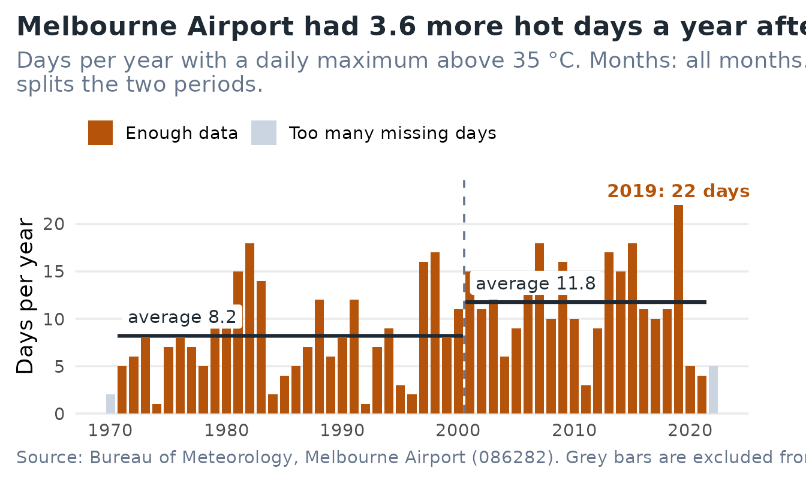
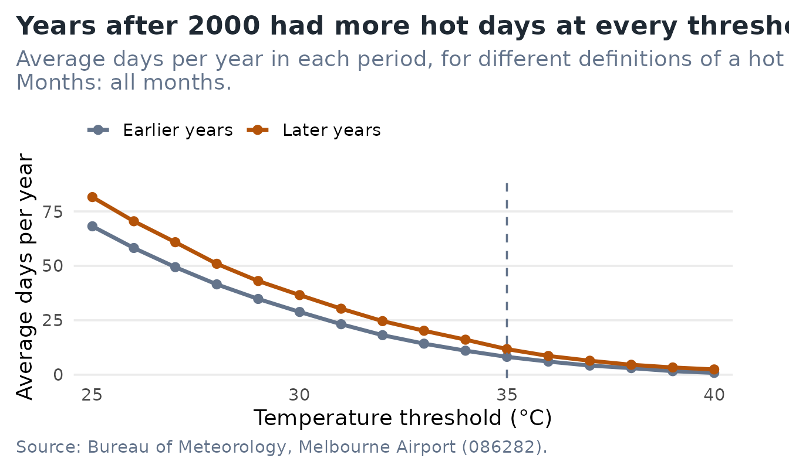
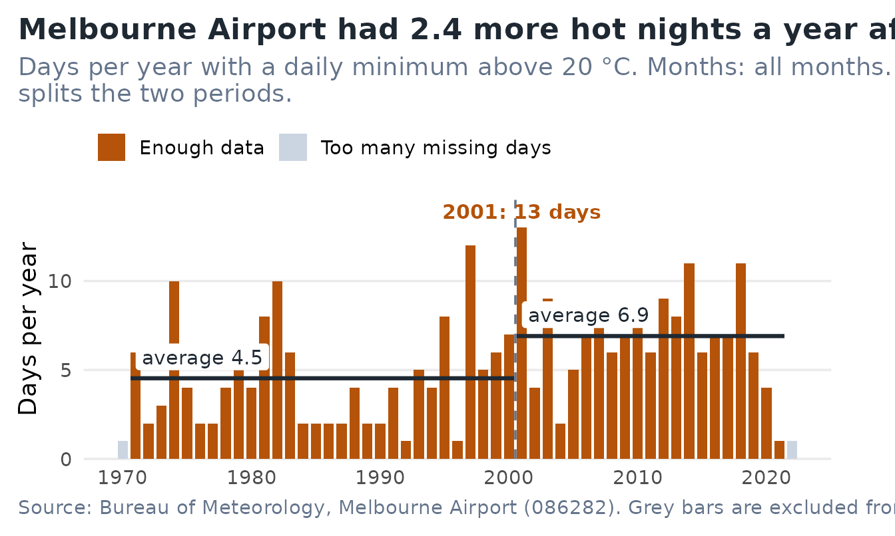

# Are hot days getting more common at Melbourne Airport?

A council or emergency-planning officer has to say, in one sentence,
whether hot weather is becoming more frequent. `melbheat` answers that
for Melbourne Airport in three steps, and this article walks through
them:

1.  count the days each year above a temperature you choose;
2.  compare an earlier period with a later one, and say how sure we can
    be;
3.  check whether the answer depends on what you count as “hot”.

By the end you will be able to reproduce every number in the app with a
few lines of code, and know how to read it and where it stops being
reliable.

## Install and launch

``` r

# install.packages("pak")
pak::pak("ETC5523-2026/etc5523-assignment-4-tngu0386-oss")
```

``` r

library(melbheat)
run_app()
```

[`run_app()`](https://etc5523-2026.github.io/etc5523-assignment-4-tngu0386-oss/reference/run_app.md)
opens the Shiny app in your browser. The app uses the `bslib` package,
so if you see a message asking for it, run `install.packages("bslib")`
first. The rest of this article uses the same functions the app calls,
so you can work in code or in the app and get identical results.

## The data

`melb_temp` has one row per calendar day, from 1 January 1970 to 26 July
2022, at the Bureau of Meteorology station 086282 (Melbourne Airport).
Days with no usable reading are kept as `NA` instead of being dropped,
so that a gap is visible rather than silent.

``` r

library(melbheat)
melb_temp[melb_temp$date >= "2019-01-24" & melb_temp$date <= "2019-01-26", ]
#>             date year month tmax tmax_quality tmin tmin_quality
#> 17921 2019-01-24 2019     1 41.9            N 17.4            N
#> 17922 2019-01-25 2019     1 46.0            N 21.0            N
#> 17923 2019-01-26 2019     1 28.1            N 17.3            N
```

| Field                          | Meaning                                    |
|:-------------------------------|:-------------------------------------------|
| `date`, `year`, `month`        | Calendar date and its year and month       |
| `tmax`, `tmin`                 | Daily maximum and minimum temperature (°C) |
| `tmax_quality`, `tmin_quality` | The Bureau’s quality flag for each reading |

The raw files and the script that builds `melb_temp` are in `data-raw/`
in the source repository, so the preparation can be re-run from scratch.

## Step 1: count hot days each year

[`annual_exceedances()`](https://etc5523-2026.github.io/etc5523-assignment-4-tngu0386-oss/reference/annual_exceedances.md)
counts the days in each year with a daily maximum above a threshold. The
threshold has no default on purpose: what counts as hot is your
decision, and the function asks for it.

``` r

ex <- annual_exceedances(threshold = 35)
tail(ex, 4)
#>    year n_days n_observed n_exceed  coverage prop_exceed reliable
#> 50 2019    365        365       22 1.0000000  0.06027397     TRUE
#> 51 2020    366        366        5 1.0000000  0.01366120     TRUE
#> 52 2021    365        365        4 1.0000000  0.01095890     TRUE
#> 53 2022    365        201        5 0.5506849  0.02487562    FALSE
```

Look at the last row. 2022 has data for only 201 of 365 days, because
the record stops in July, so `reliable` is `FALSE`. A year is only
trusted when at least 80% of its days were observed (change this with
`min_coverage`). Without that rule a short year would look like a cool
one.

[`plot_exceedances()`](https://etc5523-2026.github.io/etc5523-assignment-4-tngu0386-oss/reference/plot_exceedances.md)
draws the counts. Add `split_year` to see the two periods being
compared.

``` r

plot_exceedances(ex, split_year = 2000)
```



The title is the finding, the hottest year is the only bar that is
labelled, and grey bars are the years left out of the averages.

## Step 2: compare two periods and say how sure we are

[`summarise_periods()`](https://etc5523-2026.github.io/etc5523-assignment-4-tngu0386-oss/reference/summarise_periods.md)
averages the reliable years either side of a year you choose, and
[`describe_periods()`](https://etc5523-2026.github.io/etc5523-assignment-4-tngu0386-oss/reference/describe_periods.md)
turns the table into sentences.

``` r

periods <- summarise_periods(ex, split_year = 2000)
periods[, c("period", "n_years", "mean_exceed", "sd_exceed")]
#>            period n_years mean_exceed sd_exceed
#> 1 2000 or earlier      30      8.2000  4.693356
#> 2      after 2000      21     11.7619  5.009039
```

``` r

said <- describe_periods(periods, variable = "tmax", threshold = 35)
said$headline
#> [1] "In 2001–2021 the airport averaged 11.8 days a year with a daily maximum above 35 °C, against 8.2 in 1971–2000. That is 3.6 more hot days a year."
said$how_sure
#> [1] "The gap stands out from year-to-year noise: a rough 95% range for the difference is +0.8 to +6.3 days a year. This treats years as independent, so use it as a guide, not a formal test."
```

The “rough 95% range” is the gap between the two averages plus or minus
two standard errors. It treats each year as independent, which
neighbouring hot years are not quite, so read it as a guide to whether
the gap is bigger than ordinary year-to-year variation, not as a formal
test.

When there is nothing to compare, the function says so instead of
reporting a gap of zero. Here, a very high threshold in a single month
leaves no hot days at all:

``` r

rare <- annual_exceedances(threshold = 42, months = 7)
describe_periods(summarise_periods(rare, split_year = 2000),
                 variable = "tmax", threshold = 42)$headline
#> [1] "No year in either period had a daily maximum above 42 °C."
```

## Step 3: does the answer depend on the threshold?

A conclusion that only holds at 35 °C would be fragile.
[`threshold_sensitivity()`](https://etc5523-2026.github.io/etc5523-assignment-4-tngu0386-oss/reference/threshold_sensitivity.md)
repeats the comparison across a range of thresholds.

``` r

sens <- threshold_sensitivity(thresholds = c(30, 33, 35, 38, 40))
sens[, c("threshold", "mean_before", "mean_after", "difference")]
#>   threshold mean_before mean_after difference
#> 1        30  28.8333333  36.571429   7.738095
#> 2        33  14.2666667  20.190476   5.923810
#> 3        35   8.2000000  11.761905   3.561905
#> 4        38   3.0333333   4.571429   1.538095
#> 5        40   0.8333333   2.428571   1.595238
```

``` r

plot_sensitivity(threshold_sensitivity(), highlight = 35)
```



The later period is higher at every threshold. The gap in days is bigger
at low thresholds simply because there are more such days. The `ratio`
column puts the thresholds on a common footing: later years had roughly
1.2 to 1.5 times as many hot days at most thresholds, and a larger
multiple for the rarest days, where the counts are small and noisier.

### Hot nights

The same functions work for the daily minimum. A hot night is often
defined as a minimum above 20 °C.

``` r

nights <- annual_exceedances(variable = "tmin", threshold = 20)
plot_exceedances(nights, split_year = 2000)
```



## Use the app

Everything above is in the app, with the arithmetic hidden behind
controls.

| Control | What it does |
|:---|:---|
| What are you counting? | Hot days (daily maximum) or hot nights (daily minimum) |
| A day counts if it is above | The threshold, in °C |
| Months to include | Restrict to a season, for example December to February |
| Compare years up to … with years after | The year that splits the two periods |
| Minimum share of days observed | Under “Show advanced setting”; how complete a year must be to be used |

The **See the trend** tab shows the finding first (“What this shows” and
“How sure are we?”), then the chart, then the period table. **Does the
threshold matter?** is Step 3. **Guide** explains each field. Chart and
table can be downloaded. If your choices leave nothing to count, for
example no months ticked, the app tells you what to change instead of
showing an empty chart.

## What this can and cannot tell you

- It is **one weather station**. Other parts of Melbourne can differ.
- Readings are **as recorded**. They are not adjusted for changes in
  instruments or surroundings.
- The comparison shows that hot days were **more frequent later**. It
  does not say why.
- The result depends on the split year you choose, so try several.
- The range from
  [`describe_periods()`](https://etc5523-2026.github.io/etc5523-assignment-4-tngu0386-oss/reference/describe_periods.md)
  is a rough guide, not a hypothesis test.

Data: Australian Bureau of Meteorology, Climate Data Online. Copyright
Commonwealth of Australia, Bureau of Meteorology.
